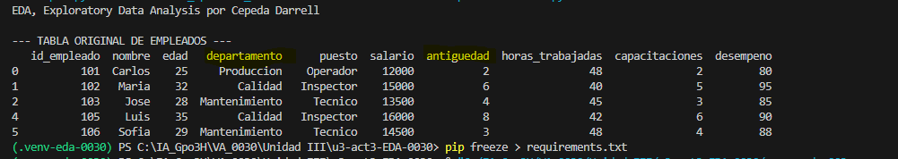

# 📊 UIII Act3: Importación y Descripción de Datos
## Cepeda Darrell NC = 0030     Fecha 11/11/2026
> **🎓 Asignatura:** Soluciona problemas de Machine Learning  
> **📚 Nivel:** Tercer semestre de preparatoria  
> **🤖 Especialidad:** Inteligencia Artificial  
> **📈 Dificultad:** Cero a principiante  
> **🐍 Lenguaje:** Python  
> **🛠️ Herramientas:** Visual Studio Code, Pandas, Matplotlib y CSV 

## Imagen original

## 7. Convertir en DataFrame el CSV

